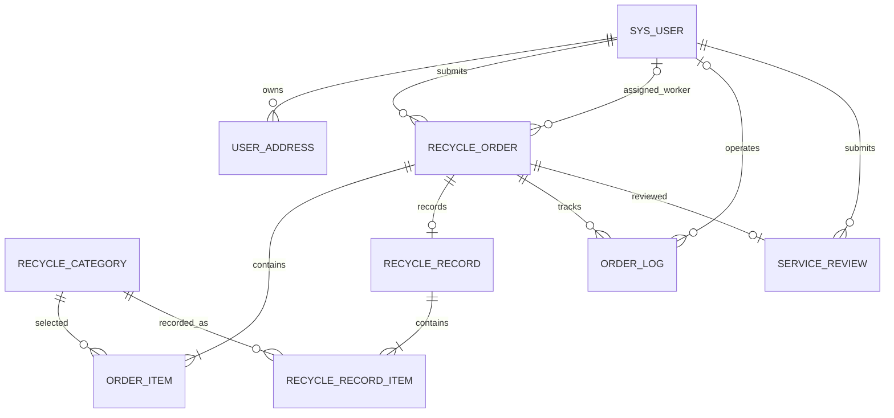

# 数据库设计文档和建表 SQL

## 1. 设计约定

- 数据库：MySQL 8.0。
- 表名和字段名使用英文，所有表和字段添加中文 `COMMENT`。
- 使用 InnoDB 和 `utf8mb4`。
- 居民、回收人员和管理员统一存放在用户表，以角色字段区分。
- 一个订单可包含多种家电；实际数量和重量按品类登记。
- 不保存回收金额。
- 用户、品类和地址不做会破坏历史关联的物理删除；历史地址和品类名称保留快照。

## 2. 实体关系



## 3. 建表 SQL

```sql
CREATE TABLE sys_user (
    id BIGINT NOT NULL AUTO_INCREMENT COMMENT '用户主键',
    username VARCHAR(50) NOT NULL COMMENT '登录账号',
    password VARCHAR(255) NOT NULL COMMENT '加密后的登录密码',
    real_name VARCHAR(50) NOT NULL COMMENT '用户姓名',
    phone VARCHAR(20) DEFAULT NULL COMMENT '联系电话',
    role VARCHAR(20) NOT NULL COMMENT '用户角色：RESIDENT居民、WORKER回收人员、ADMIN管理员',
    status TINYINT NOT NULL DEFAULT 1 COMMENT '账号状态：1启用、0停用',
    created_at DATETIME NOT NULL DEFAULT CURRENT_TIMESTAMP COMMENT '账号创建时间',
    updated_at DATETIME NOT NULL DEFAULT CURRENT_TIMESTAMP ON UPDATE CURRENT_TIMESTAMP COMMENT '账号信息更新时间',
    PRIMARY KEY (id),
    UNIQUE KEY uk_sys_user_username (username),
    KEY idx_sys_user_role_status (role, status)
) ENGINE=InnoDB DEFAULT CHARSET=utf8mb4 COMMENT='系统用户表';

CREATE TABLE user_address (
    id BIGINT NOT NULL AUTO_INCREMENT COMMENT '地址主键',
    user_id BIGINT NOT NULL COMMENT '所属居民用户ID',
    contact_name VARCHAR(50) NOT NULL COMMENT '回收联系人姓名',
    contact_phone VARCHAR(20) NOT NULL COMMENT '回收联系人电话',
    region VARCHAR(150) NOT NULL COMMENT '所在区域',
    detail_address VARCHAR(255) NOT NULL COMMENT '详细地址',
    address_remark VARCHAR(255) DEFAULT NULL COMMENT '地址补充说明',
    is_default TINYINT NOT NULL DEFAULT 0 COMMENT '是否默认地址：1是、0否',
    is_deleted TINYINT NOT NULL DEFAULT 0 COMMENT '是否已删除：1是、0否',
    created_at DATETIME NOT NULL DEFAULT CURRENT_TIMESTAMP COMMENT '地址创建时间',
    updated_at DATETIME NOT NULL DEFAULT CURRENT_TIMESTAMP ON UPDATE CURRENT_TIMESTAMP COMMENT '地址更新时间',
    PRIMARY KEY (id),
    KEY idx_user_address_user_id (user_id),
    CONSTRAINT fk_user_address_user FOREIGN KEY (user_id) REFERENCES sys_user (id)
) ENGINE=InnoDB DEFAULT CHARSET=utf8mb4 COMMENT='居民回收地址表';

CREATE TABLE recycle_category (
    id BIGINT NOT NULL AUTO_INCREMENT COMMENT '回收品类主键',
    name VARCHAR(100) NOT NULL COMMENT '品类名称',
    description VARCHAR(500) DEFAULT NULL COMMENT '品类说明',
    recycle_requirements VARCHAR(500) DEFAULT NULL COMMENT '回收要求',
    status TINYINT NOT NULL DEFAULT 1 COMMENT '品类状态：1启用、0停用',
    created_at DATETIME NOT NULL DEFAULT CURRENT_TIMESTAMP COMMENT '品类创建时间',
    updated_at DATETIME NOT NULL DEFAULT CURRENT_TIMESTAMP ON UPDATE CURRENT_TIMESTAMP COMMENT '品类更新时间',
    PRIMARY KEY (id),
    UNIQUE KEY uk_recycle_category_name (name)
) ENGINE=InnoDB DEFAULT CHARSET=utf8mb4 COMMENT='废旧家电回收品类表';

CREATE TABLE recycle_order (
    id BIGINT NOT NULL AUTO_INCREMENT COMMENT '订单主键',
    order_no VARCHAR(40) NOT NULL COMMENT '订单编号',
    resident_id BIGINT NOT NULL COMMENT '提交订单的居民用户ID',
    worker_id BIGINT DEFAULT NULL COMMENT '当前分派的回收人员用户ID',
    status VARCHAR(40) NOT NULL COMMENT '订单状态编码',
    appointment_time DATETIME NOT NULL COMMENT '预约上门回收时间',
    contact_name VARCHAR(50) NOT NULL COMMENT '订单联系人姓名快照',
    contact_phone VARCHAR(20) NOT NULL COMMENT '订单联系电话快照',
    region VARCHAR(150) NOT NULL COMMENT '订单所在区域快照',
    detail_address VARCHAR(255) NOT NULL COMMENT '订单详细地址快照',
    address_remark VARCHAR(255) DEFAULT NULL COMMENT '订单地址补充说明快照',
    description VARCHAR(1000) DEFAULT NULL COMMENT '家电状况及申请补充说明',
    cancel_reason VARCHAR(500) DEFAULT NULL COMMENT '订单取消原因',
    created_at DATETIME NOT NULL DEFAULT CURRENT_TIMESTAMP COMMENT '订单提交时间',
    updated_at DATETIME NOT NULL DEFAULT CURRENT_TIMESTAMP ON UPDATE CURRENT_TIMESTAMP COMMENT '订单更新时间',
    completed_at DATETIME DEFAULT NULL COMMENT '居民确认后订单完成时间',
    PRIMARY KEY (id),
    UNIQUE KEY uk_recycle_order_order_no (order_no),
    KEY idx_recycle_order_resident (resident_id),
    KEY idx_recycle_order_worker_status (worker_id, status),
    KEY idx_recycle_order_status_created (status, created_at),
    CONSTRAINT fk_recycle_order_resident FOREIGN KEY (resident_id) REFERENCES sys_user (id),
    CONSTRAINT fk_recycle_order_worker FOREIGN KEY (worker_id) REFERENCES sys_user (id)
) ENGINE=InnoDB DEFAULT CHARSET=utf8mb4 COMMENT='废旧家电回收订单表';

CREATE TABLE order_item (
    id BIGINT NOT NULL AUTO_INCREMENT COMMENT '订单明细主键',
    order_id BIGINT NOT NULL COMMENT '所属回收订单ID',
    category_id BIGINT NOT NULL COMMENT '回收品类ID',
    category_name VARCHAR(100) NOT NULL COMMENT '提交订单时的品类名称快照',
    estimated_quantity INT NOT NULL COMMENT '居民预计回收数量',
    item_description VARCHAR(500) DEFAULT NULL COMMENT '该品类家电状况说明',
    created_at DATETIME NOT NULL DEFAULT CURRENT_TIMESTAMP COMMENT '明细创建时间',
    PRIMARY KEY (id),
    KEY idx_order_item_order_id (order_id),
    KEY idx_order_item_category_id (category_id),
    CONSTRAINT fk_order_item_order FOREIGN KEY (order_id) REFERENCES recycle_order (id),
    CONSTRAINT fk_order_item_category FOREIGN KEY (category_id) REFERENCES recycle_category (id),
    CONSTRAINT chk_order_item_estimated_quantity CHECK (estimated_quantity > 0)
) ENGINE=InnoDB DEFAULT CHARSET=utf8mb4 COMMENT='回收订单家电明细表';

CREATE TABLE recycle_record (
    id BIGINT NOT NULL AUTO_INCREMENT COMMENT '回收记录主键',
    order_id BIGINT NOT NULL COMMENT '对应的回收订单ID',
    worker_id BIGINT NOT NULL COMMENT '登记回收结果的回收人员用户ID',
    remark VARCHAR(500) DEFAULT NULL COMMENT '回收结果备注',
    recorded_at DATETIME NOT NULL DEFAULT CURRENT_TIMESTAMP COMMENT '回收结果登记时间',
    resident_confirmed_at DATETIME DEFAULT NULL COMMENT '居民确认回收结果的时间',
    PRIMARY KEY (id),
    UNIQUE KEY uk_recycle_record_order_id (order_id),
    KEY idx_recycle_record_worker_id (worker_id),
    CONSTRAINT fk_recycle_record_order FOREIGN KEY (order_id) REFERENCES recycle_order (id),
    CONSTRAINT fk_recycle_record_worker FOREIGN KEY (worker_id) REFERENCES sys_user (id)
) ENGINE=InnoDB DEFAULT CHARSET=utf8mb4 COMMENT='回收结果记录表';

CREATE TABLE recycle_record_item (
    id BIGINT NOT NULL AUTO_INCREMENT COMMENT '回收结果明细主键',
    record_id BIGINT NOT NULL COMMENT '所属回收记录ID',
    category_id BIGINT NOT NULL COMMENT '实际回收品类ID',
    category_name VARCHAR(100) NOT NULL COMMENT '登记时的品类名称快照',
    actual_quantity INT NOT NULL COMMENT '该品类实际回收数量',
    actual_weight DECIMAL(10,2) NOT NULL COMMENT '该品类实际回收重量',
    weight_unit VARCHAR(10) NOT NULL DEFAULT 'kg' COMMENT '重量单位',
    created_at DATETIME NOT NULL DEFAULT CURRENT_TIMESTAMP COMMENT '明细创建时间',
    PRIMARY KEY (id),
    KEY idx_record_item_record_id (record_id),
    KEY idx_record_item_category_id (category_id),
    CONSTRAINT fk_record_item_record FOREIGN KEY (record_id) REFERENCES recycle_record (id),
    CONSTRAINT fk_record_item_category FOREIGN KEY (category_id) REFERENCES recycle_category (id),
    CONSTRAINT chk_record_item_actual_quantity CHECK (actual_quantity >= 0),
    CONSTRAINT chk_record_item_actual_weight CHECK (actual_weight >= 0)
) ENGINE=InnoDB DEFAULT CHARSET=utf8mb4 COMMENT='回收结果明细表';

CREATE TABLE order_log (
    id BIGINT NOT NULL AUTO_INCREMENT COMMENT '订单操作记录主键',
    order_id BIGINT NOT NULL COMMENT '对应的回收订单ID',
    operator_id BIGINT DEFAULT NULL COMMENT '操作人用户ID',
    action VARCHAR(50) NOT NULL COMMENT '操作类型',
    from_status VARCHAR(40) DEFAULT NULL COMMENT '操作前订单状态',
    to_status VARCHAR(40) DEFAULT NULL COMMENT '操作后订单状态',
    comment VARCHAR(500) DEFAULT NULL COMMENT '审核意见、拒绝原因或处理说明',
    created_at DATETIME NOT NULL DEFAULT CURRENT_TIMESTAMP COMMENT '操作发生时间',
    PRIMARY KEY (id),
    KEY idx_order_log_order_id_created (order_id, created_at),
    KEY idx_order_log_operator_id (operator_id),
    CONSTRAINT fk_order_log_order FOREIGN KEY (order_id) REFERENCES recycle_order (id),
    CONSTRAINT fk_order_log_operator FOREIGN KEY (operator_id) REFERENCES sys_user (id)
) ENGINE=InnoDB DEFAULT CHARSET=utf8mb4 COMMENT='订单操作记录表';

CREATE TABLE service_review (
    id BIGINT NOT NULL AUTO_INCREMENT COMMENT '服务评价主键',
    order_id BIGINT NOT NULL COMMENT '被评价的回收订单ID',
    resident_id BIGINT NOT NULL COMMENT '提交评价的居民用户ID',
    rating TINYINT NOT NULL COMMENT '服务评分，范围为1至5分',
    content VARCHAR(1000) DEFAULT NULL COMMENT '评价文字内容',
    created_at DATETIME NOT NULL DEFAULT CURRENT_TIMESTAMP COMMENT '评价提交时间',
    PRIMARY KEY (id),
    UNIQUE KEY uk_service_review_order_id (order_id),
    KEY idx_service_review_resident_id (resident_id),
    CONSTRAINT fk_service_review_order FOREIGN KEY (order_id) REFERENCES recycle_order (id),
    CONSTRAINT fk_service_review_resident FOREIGN KEY (resident_id) REFERENCES sys_user (id),
    CONSTRAINT chk_service_review_rating CHECK (rating BETWEEN 1 AND 5)
) ENGINE=InnoDB DEFAULT CHARSET=utf8mb4 COMMENT='回收服务评价表';
```

## 4. 表关系与说明

- 一个居民可维护多个地址并提交多个订单。
- 一个订单通过 `order_item` 保存一种或多种申报家电。
- 一个订单在当前时刻关联一名回收人员；重新分派历史由 `order_log` 留痕。
- 一个订单最多有一条回收结果主记录，结果明细按品类保存实际数量和重量。
- 一个订单可有多条操作记录，最多有一条服务评价。
- `recycle_order` 保存地址快照，明细表保存品类名称快照，避免主数据修改影响历史展示。
- 外键约束用于保证关联数据存在；业务层还需校验角色、资源归属和订单状态。
- `CHECK` 约束在 MySQL 8.0.16 及以上版本执行；业务层仍需同步校验。

## 5. 状态编码建议

`PENDING_REVIEW` 待审核、`PENDING_ASSIGNMENT` 待分派、`PENDING_ACCEPTANCE` 待接单、`ACCEPTED` 已接单、`IN_PROGRESS` 回收中、`PENDING_RESIDENT_CONFIRMATION` 待居民确认、`COMPLETED` 已完成、`REJECTED` 已驳回、`CANCELLED` 已取消、`PENDING_REASSIGNMENT` 待重新分派、`EXCEPTION_PENDING` 异常待处理。
