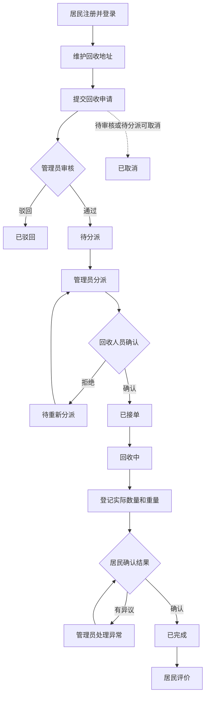

# 用例分析及业务流程图

## 1. 参与者

| 参与者 | 职责 |
|---|---|
| 居民 | 自行注册，维护地址，提交回收申请，跟踪订单，确认回收结果并评价 |
| 回收人员 | 查看分派任务，确认或拒绝接单，更新进度并登记实际回收数量和重量 |
| 社区管理员 | 管理用户及品类，审核和分派订单，处理取消请求与异常，查看统计 |

## 2. 用例清单

### 2.1 居民用例

| 编号 | 用例 | 说明 |
|---|---|---|
| R01 | 注册与登录 | 居民自行注册，无手机验证码，并登录系统 |
| R02 | 维护个人资料 | 查询和修改本人资料 |
| R03 | 管理回收地址 | 新增、修改、删除地址及设置默认地址 |
| R04 | 查询回收品类 | 查看当前启用品类及回收要求 |
| R05 | 提交回收申请 | 填写预约、地址、品类、预计数量和说明 |
| R06 | 查询本人订单 | 查看本人订单和处理进度 |
| R07 | 取消订单 | 在“待审核”或“待分派”时取消订单 |
| R08 | 确认回收结果 | 查看按品类登记的实际数量和重量并确认或提出异议 |
| R09 | 评价服务 | 对已完成订单提交一次评价 |

### 2.2 回收人员用例

| 编号 | 用例 | 说明 |
|---|---|---|
| W01 | 登录 | 使用管理员创建的回收人员账号登录 |
| W02 | 查询本人任务 | 查看分派给本人的回收任务 |
| W03 | 确认接单 | 接受待接单任务 |
| W04 | 拒绝接单 | 填写拒绝原因并交由管理员重新分派 |
| W05 | 更新回收进度 | 将已接单任务更新为回收中 |
| W06 | 登记回收结果 | 按品类登记实际数量和重量，不登记金额 |
| W07 | 提交异常 | 报告联系不上居民、地址错误等执行异常 |

### 2.3 管理员用例

| 编号 | 用例 | 说明 |
|---|---|---|
| A01 | 管理用户 | 查询、启用或停用用户账号，维护回收人员 |
| A02 | 管理品类 | 新增、修改、启用或停用品类 |
| A03 | 审核申请 | 通过或驳回待审核订单 |
| A04 | 分派订单 | 将审核通过的订单分派给回收人员 |
| A05 | 重新分派 | 处理拒绝接单或无法执行的任务 |
| A06 | 处理取消请求 | 处理已分派后居民提出的取消请求 |
| A07 | 处理异常 | 处理回收异常和居民结果异议 |
| A08 | 查询订单和评价 | 按条件查询业务记录 |
| A09 | 查询统计 | 查询订单量、回收数量和实际重量 |

## 3. 核心用例描述

### 3.1 居民提交回收申请

- **前置条件：** 居民已登录，存在有效地址和启用中的回收品类。
- **基本流程：** 居民选择品类并填写预计数量、家电状况、地址和预约时间；系统校验数据；提交成功后生成订单编号，状态为“待审核”。
- **异常流程：** 必填信息缺失或格式错误时提示修改；失败时不生成重复订单。
- **后置条件：** 保存订单及品类明细。

### 3.2 管理员审核和分派

- **前置条件：** 管理员已登录，订单为“待审核”。
- **基本流程：** 管理员查看申请；通过后订单变为“待分派”，驳回则填写原因并变为“已驳回”；管理员选择回收人员分派后，订单变为“待接单”。
- **异常流程：** 订单状态已变化或回收人员已停用时拒绝操作并提示刷新或重新选择。
- **后置条件：** 记录审核、分派人和时间。

### 3.3 回收人员处理任务

- **前置条件：** 任务已分派给当前回收人员，状态为“待接单”。
- **基本流程：** 回收人员确认接单，状态变为“已接单”；开始执行后改为“回收中”；上门完成后按品类登记实际数量和重量，订单进入“待居民确认”。
- **备选流程：** 拒绝接单并填写原因，订单进入“待重新分派”。
- **后置条件：** 保存操作及回收结果记录。

### 3.4 居民确认结果

- **前置条件：** 居民本人订单处于“待居民确认”。
- **基本流程：** 居民查看实际回收明细并确认；系统记录确认人和时间，订单变为“已完成”。
- **备选流程：** 居民提出异议，订单交管理员处理；处理后返回居民确认。
- **后置条件：** 已确认订单可进行服务评价。

### 3.5 居民取消订单

- **前置条件：** 订单属于当前居民，状态为“待审核”或“待分派”。
- **基本流程：** 居民发起取消；系统校验状态，记录取消操作并将订单设为“已取消”。
- **异常流程：** 订单已分派后不允许居民直接取消，提示联系管理员。

## 4. 核心业务流程图

## 5. 订单状态操作约束

| 操作 | 执行角色 | 当前状态 | 结果状态 |
|---|---|---|---|
| 审核通过 | 管理员 | 待审核 | 待分派 |
| 驳回申请 | 管理员 | 待审核 | 已驳回 |
| 居民取消 | 居民本人 | 待审核、待分派 | 已取消 |
| 分派回收人员 | 管理员 | 待分派、待重新分派 | 待接单 |
| 确认接单 | 被分派人员 | 待接单 | 已接单 |
| 拒绝接单 | 被分派人员 | 待接单 | 待重新分派 |
| 开始回收 | 被分派人员 | 已接单 | 回收中 |
| 登记回收结果 | 被分派人员 | 回收中 | 待居民确认 |
| 居民确认 | 订单所属居民 | 待居民确认 | 已完成 |
| 提出异议 | 订单所属居民 | 待居民确认 | 异常待处理 |

## 6. 权限约束

- 居民只能查看和操作本人资料、地址和订单。
- 回收人员只能查看和处理分派给本人的任务。
- 管理员按社区管理权限处理用户、品类和订单。
- 所有状态转换由后端校验并写入订单操作记录。
