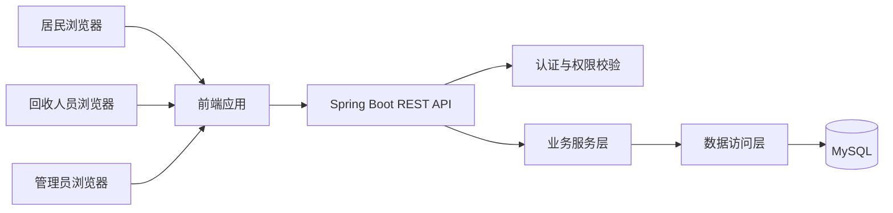
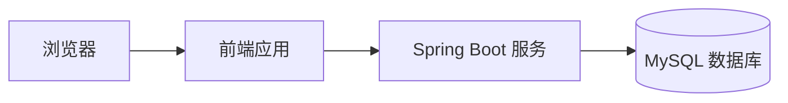

# 系统总体设计文档

## 1. 设计目标

系统面向社区废旧家电回收业务，完成居民申请、管理员审核与分派、回收人员确认接单及现场登记、居民确认和评价的业务闭环。系统按角色控制访问，确保订单状态和处理记录可追溯。

## 2. 系统架构

采用 B/S 前后端分离架构。前端通过 REST API 与 Spring Boot 后端通信，后端完成身份认证、权限校验、业务处理和数据访问，MySQL 保存业务数据。

## 3. 分层职责

### 3.1 表现层

负责页面展示、表单交互、前端输入提示和接口调用。按居民、回收人员、管理员展示对应菜单。中文状态名称由前端根据接口状态编码映射显示。

### 3.2 接口层

接收 HTTP 请求，执行参数校验、身份识别和权限入口校验，返回统一 JSON 结构。接口层不直接实现复杂订单业务规则。

### 3.3 业务服务层

实现注册、地址和品类管理、订单创建、审核、分派、接单、回收结果登记、居民确认、取消、异常处理、评价和统计等业务规则。

### 3.4 数据访问层

负责访问用户、地址、品类、订单、订单明细、回收记录、操作日志和评价等数据。

### 3.5 数据存储层

使用 MySQL 保存关系型业务数据。订单地址和品类名称保留必要快照；回收结果按品类保存实际数量和重量，不保存金额。

## 4. 功能模块

| 模块 | 职责 |
|---|---|
| 账号与权限 | 居民注册、登录、个人资料、角色和账号状态控制 |
| 地址管理 | 居民地址新增、修改、删除和默认地址设置 |
| 品类管理 | 居民查询品类，管理员维护启停及说明 |
| 回收申请 | 居民创建申请、查询订单、按规则取消 |
| 订单审核分派 | 管理员审核、驳回、分派和重新分派 |
| 回收任务 | 回收人员查询任务、确认或拒绝、更新进度 |
| 回收结果 | 回收人员按品类登记数量和重量 |
| 居民确认 | 居民确认结果或提出异议 |
| 评价管理 | 居民提交评价，管理员查看评价 |
| 统计查询 | 订单数量、品类回收量和实际重量统计 |
| 操作追踪 | 记录关键状态变更、操作人、时间及说明 |

## 5. 核心业务流程

1. 居民注册、登录并维护回收地址。
2. 居民选择品类、填写预计数量和预约信息，提交订单，状态为“待审核”。
3. 管理员审核，通过后状态为“待分派”；驳回后进入“已驳回”。
4. 管理员分派回收人员，状态为“待接单”。
5. 回收人员确认后状态为“已接单”；拒绝后进入“待重新分派”。
6. 回收人员开始执行后状态为“回收中”。
7. 回收人员按品类登记实际数量和重量，状态为“待居民确认”。
8. 居民确认后订单变为“已完成”；有异议则交管理员处理。
9. 居民可评价已完成订单。

居民只能在“待审核”或“待分派”时自行取消。订单已分派后，取消请求由管理员处理。

## 6. 订单状态设计

| 状态编码 | 中文名称 |
|---|---|
| `PENDING_REVIEW` | 待审核 |
| `PENDING_ASSIGNMENT` | 待分派 |
| `PENDING_ACCEPTANCE` | 待接单 |
| `ACCEPTED` | 已接单 |
| `IN_PROGRESS` | 回收中 |
| `PENDING_RESIDENT_CONFIRMATION` | 待居民确认 |
| `COMPLETED` | 已完成 |
| `REJECTED` | 已驳回 |
| `CANCELLED` | 已取消 |
| `PENDING_REASSIGNMENT` | 待重新分派 |
| `EXCEPTION_PENDING` | 异常待处理 |

状态编码由后端业务逻辑控制，前端不应直接设置任意目标状态。

## 7. 权限设计原则

- 居民只能访问本人地址和订单。
- 回收人员只能访问分派给本人的任务。
- 管理员可管理社区业务数据。
- 每次状态操作都校验角色、资源归属和当前状态。
- 关键操作记录操作者、操作时间、前后状态和说明。

## 8. 部署结构

前端和后端可分别部署；课程或毕业设计环境也可由后端提供静态页面。数据库独立运行，连接信息通过环境配置提供。

## 9. 技术组件建议

- 后端：Spring Boot、Spring MVC、参数校验组件。
- 数据访问：MyBatis-Plus 或 MyBatis，项目确定后选定一种。
- 数据库：MySQL。
- 前端：可采用 Vue 3 和 Element Plus；若项目不要求前后端分离，可采用服务端模板方案。
- 身份认证：采用适合项目规模的会话或令牌认证方案，服务端强制校验权限。

技术组件为建议选型，需与最终实际实现保持一致。
